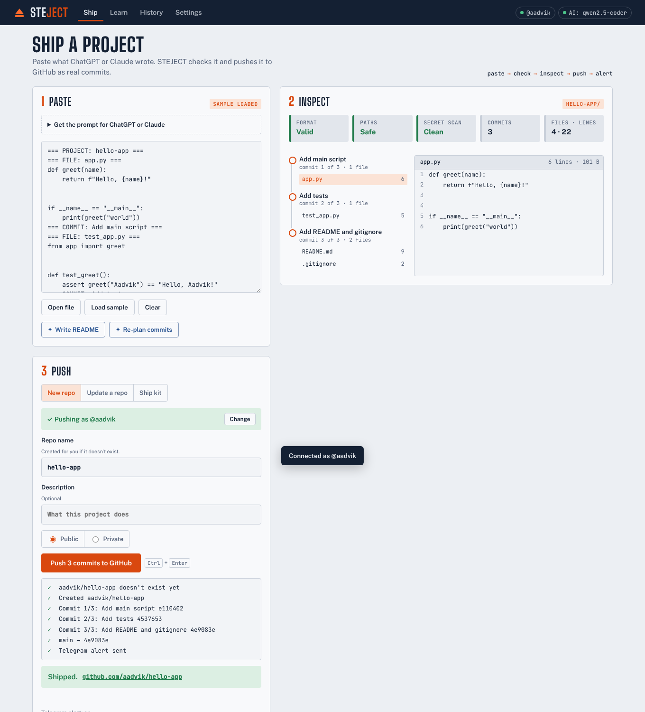
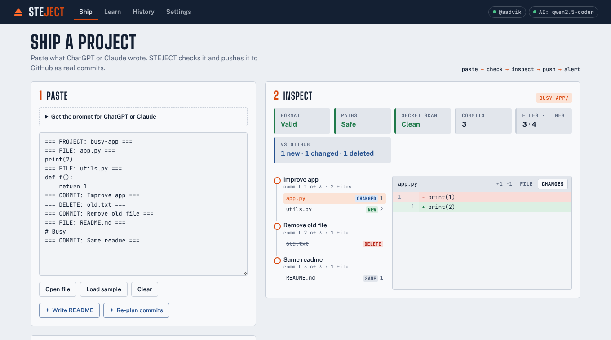
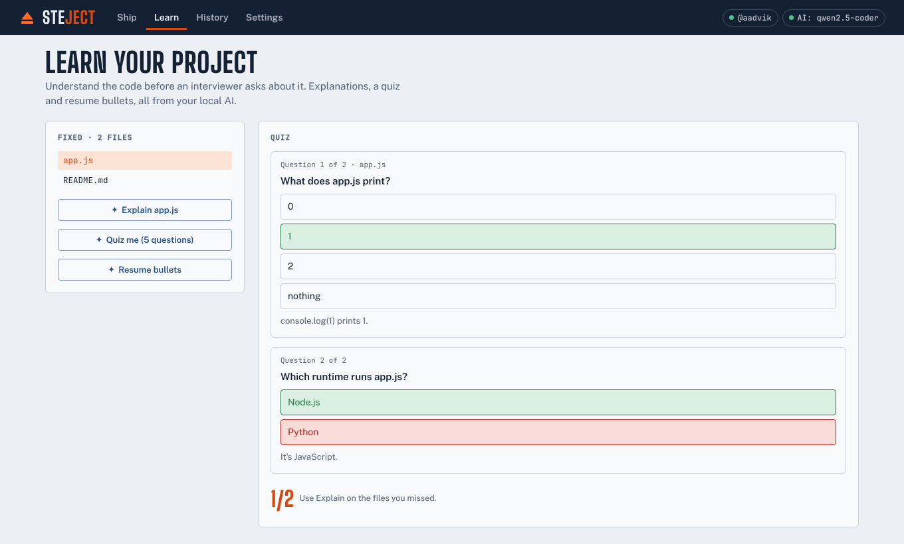

<p align="center"></p>

<h1 align="center">STEJECT</h1>

<p align="center"><b>From an idea or a chat reply to a real, tested GitHub repo you actually understand.</b><br>
Desktop app for Windows, Mac and Linux, plus a web version. Free, open source, no server, private by default.</p>

<p align="center">
  <a href="../../releases/latest"><b>⬇ Download the app</b></a> ·
  <a href="docs/USER-GUIDE.md">User guide</a> ·
  <a href="PROMPT_TEMPLATE.md">Prompts</a> ·
  <a href="CONTRIBUTING.md">Contribute</a> ·
  <a href="ROADMAP.md">Roadmap</a>
</p>



## Why

Chat AIs can write a whole project in one reply. Getting it onto GitHub still means creating folders, copying files one by one, writing commit messages and pushing. STEJECT does that part for you, and then helps you actually understand the code you're about to put on your resume.

## What it does

- **Paste and check:** paste the AI's reply. STEJECT checks the format and every file path, and scans for leaked API keys before anything leaves your computer.
- **Works with normal replies too:** if the AI ignored the format, STEJECT finds each file name and its code block and builds the commit plan itself. No AI needed.
- **Inspect:** read every file and the full commit plan first.
- **One-click push:** creates the repo and pushes real commits through the GitHub API. No Git install, no terminal.
- **Update mode:** paste changes for an existing repo. STEJECT shows what's new, changed or deleted compared with GitHub, then adds commits on top. It never overwrites history.
- **Resume:** if your internet drops mid-push, continue from where it stopped.
- **Checkpoints and undo:** every AI change saves a checkpoint you can restore in one click, and the last push to a repo can be undone (a safe revert commit, or a reset).
- **Telegram alerts:** get a message when a push succeeds or fails.
- **Ship it for me:** one button from idea to pushed repo: plan (you approve it), write, check, AI fixes, safety checks, push. You set the limits (AI calls, tokens, files, fix tries); private repo by default; it never pushes a secret.
- **Start from an idea, plan first:** describe a project (or pick one of 18 starters) and the AI proposes a file tree and commit plan. Edit it, approve it, and only then are the files written.
- **Check it runs, and fix it:** Python tests or the main script run in the browser, and web pages open in a sandbox. In the desktop app, Node.js, Go, Java and C/C++ projects run with your own installed tools, after you approve the exact commands, in a throwaway folder with no network for package managers. If it fails, the error goes back to the AI to fix, up to 3 tries.
- **Live preview:** web projects show in a sandboxed preview tab with no network access.
- **Change it by chatting:** type "add a delete command" and get only the changed files as a new commit, with a diff.
- **Open an existing project:** a local folder or a GitHub repo, to explain, improve or extend it.
- **Pull requests:** push to a new branch and open a PR instead of writing to main. For repos you can't push to, STEJECT uses your fork.
- **Repo doctor:** a score out of 100 and a plain-words checklist for any GitHub repo (README, license, .gitignore and committed junk, tests, CI, big files, leaked secrets, old dependencies, structure), and **Fix it** turns the gaps into a reviewable pull request.
- **Repo polish pack:** LICENSE, .gitignore, issue templates, a CI workflow, and AGENTS.md + CLAUDE.md for AI coding tools.
- **AI helper, your choice:**
  - **Free cloud (Groq):** paste a free API key and it works in a minute. Your text goes to Groq.
  - **Ollama:** free and private, running on your computer.
  - **In my browser (no key):** a small model runs on your graphics card with WebGPU. No key, no account, nothing to install, and nothing leaves your computer. Weaker than the others; best for Learn and small projects.
  - **Any OpenAI-style service:** OpenRouter, Google Gemini, LM Studio or your college's server, with a usage counter for free-tier limits.
- **Learn mode:** explains every file the way an interviewer would ask about it, quizzes you, runs a mock interview, and writes resume bullets. An optional **understanding gate** makes you pass before you push, and can add your score to the README.
- **History:** every project you've shipped, with links.
- **Ship kit:** no token? Download a script that builds the repo with Git on your computer.

| Update mode with changes view | Learn mode quiz |
|---|---|
|  |  |

## Install

Download the file for your computer from the [latest release](../../releases/latest):

| Computer | File |
|---|---|
| Windows | `STEJECT-x.y.z-win-x64.exe` (installer) or `STEJECT-x.y.z-portable.exe` |
| Mac with Apple chip | `STEJECT-x.y.z-mac-arm64.dmg` |
| Mac with Intel chip | `STEJECT-x.y.z-mac-x64.dmg` |
| Linux | `.AppImage` or `.deb` |

The app isn't code-signed yet, so the first launch shows a warning:
- **Windows:** *More info* → *Run anyway*
- **Mac:** right-click the app → *Open* → *Open* (or run `xattr -cr /Applications/STEJECT.app`)
- **Linux:** `chmod +x STEJECT-*.AppImage`, then run it

Prefer the browser? The web version runs on this repo's GitHub Pages site and can be installed as an app from Chrome or Edge.

## First run (5 minutes)

1. **GitHub:** Settings → paste a [classic token with the `repo` and `workflow` scopes](https://github.com/settings/tokens/new?scopes=repo,workflow&description=STEJECT) → Connect. (`workflow` is only needed to push CI files.)
2. **Telegram (optional):** create a bot with @BotFather, paste its token, click *Find my chat ID*, then *Send test message*.
3. **AI helper (optional):** paste a free key from [console.groq.com/keys](https://console.groq.com/keys) in Settings → AI helper → *Free cloud (Groq)*, install [Ollama](https://ollama.com/download) and click *Download* next to `qwen2.5-coder:3b`, or add any OpenAI-style service under *Other*.

Then either open **Start from an idea** (AI helper needed), or copy the prompt from the Ship page into ChatGPT or Claude, paste the reply, and click Push.

## The manifest format

```
=== PROJECT: hello-app ===
=== FILE: app.py ===
print("hello")
=== COMMIT: Add main script ===
=== FILE: README.md ===
# hello-app
=== DELETE: old.py ===
=== COMMIT: Add README, remove old script ===
```

Files and deletes belong to the next `COMMIT` line. Full prompts: [PROMPT_TEMPLATE.md](PROMPT_TEMPLATE.md).

## Privacy and safety

- Tokens are encrypted with your operating system's keychain (desktop app) and stored only on your computer.
- The app's security policy lets the page call only: GitHub (`api.github.com`, `raw.githubusercontent.com`), Telegram, Groq, OpenRouter, Google Gemini, the npm and PyPI registries (Repo doctor), and this computer (Ollama, LM Studio). Everything else is blocked.
- If you add your own AI address in Settings (for example a college server), requests to that one https address go through a small background worker (`js/networker.js`) that refuses anything but https, or http on this computer.
- Downloads that happen only when you use a feature: Python for *Check it runs* (Pyodide, from `cdn.jsdelivr.net`) and the in-browser AI model (from Hugging Face). Your code is never uploaded for these.
- With a cloud AI, the ideas and project text you use AI on are sent to that service. Use Ollama for code that must stay private.
- *Check it runs* never runs AI-written code with access to your tokens. Python runs in a separate Web Worker using [Pyodide](https://pyodide.org) (downloaded once from jsDelivr, about 10 MB). Web projects open in a sandboxed frame that has no network access at all.
- **Safety checks before every push.** Secrets always block the push, with no override: GitHub, AWS, OpenAI-style, Groq, Google, Hugging Face, npm, Slack or Stripe keys, private keys, or hardcoded passwords, in the files *and* in commit messages.
- Warnings you must confirm before pushing: dependency names one or two letters off a popular package (a common malware trick), deprecated or hijacked packages, Python standard-library names in `requirements.txt`, install scripts that run on `npm install`, unpinned or URL dependencies, and GPL-licensed files in an MIT/Apache/BSD project.
- STEJECT never force-pushes over existing history. Replacing GitHub's single "Initial commit" requires your confirmation.

## Development

```bash
npm install
npm start              # run the desktop app
npm test               # unit tests
npm run test:e2e       # UI tests against mocked GitHub, Telegram, Groq, Pyodide and Ollama
npm run test:desktop   # desktop app smoke test (use xvfb-run on Linux servers)
npm run dist           # build installers for your OS into dist/
```

The app is plain HTML, CSS and JavaScript in `app/` with no build step. `electron/` wraps it as a desktop app. Releases are built by GitHub Actions (`.github/workflows/release.yml`) whenever a `v*` tag is pushed.

```
app/            the app (also served as the web version)
  js/core.js    manifest parser, converter, secret scan, diff, plans, polish pack
  js/github.js  GitHub API: create repo, push, update, resume, import, pull requests
  js/ai.js      Ollama, Groq and OpenAI-style clients, Telegram, AI prompts
  js/runner.js  "check it runs": Python worker + sandboxed web preview
  js/pyworker.js  Pyodide runner (Web Worker)
  js/app.js     UI controller
  preview.html  sandboxed page for web project previews
  starters/     starter gallery (contributions welcome)
electron/       desktop wrapper (main process + preload bridge)
test/           unit, UI and desktop tests
```

## Contribute

STEJECT is built by and for students. Contributions are very welcome, especially from first-timers.

- **How to contribute:** read [CONTRIBUTING.md](CONTRIBUTING.md) (setup, where things are, the three rules: no server, private by default, plain words). Be kind: [Code of Conduct](CODE_OF_CONDUCT.md).
- **How to add a starter:** add one object to [`app/starters/starters.js`](app/starters/starters.js) and open a pull request. Full starters with a tested reference project go in the [steject-starters repo](docs/STARTERS-REPO.md).
- **What's next:** [ROADMAP.md](ROADMAP.md). **Security problems:** [SECURITY.md](SECURITY.md), never a public issue.

## License

[MIT](LICENSE). Fonts are under the SIL Open Font License. JSZip, marked and DOMPurify licenses are in `app/vendor/`.
